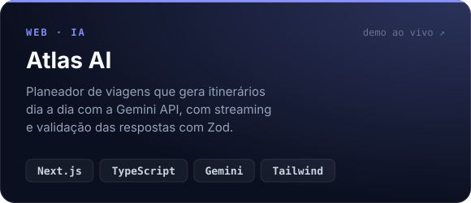
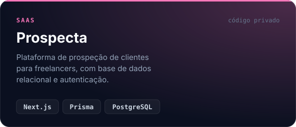
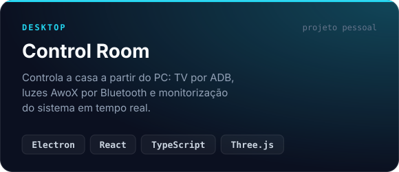
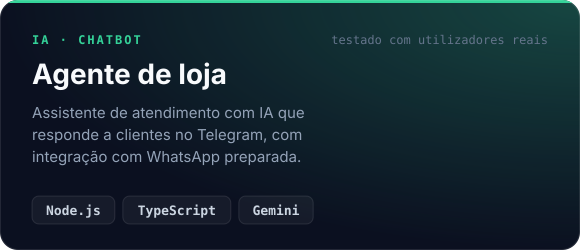
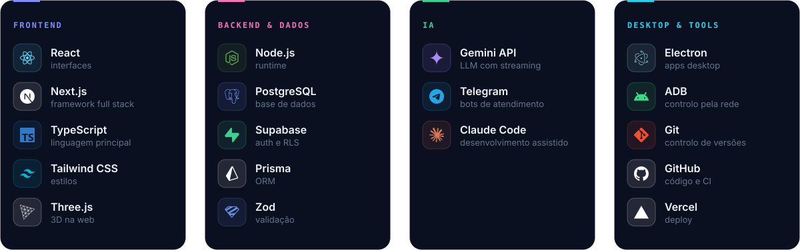

  
  
  

 

Sou developer full stack júnior em Lisboa. Construo aplicações web de ponta a ponta, da base de dados à interface, e uso IA quando acrescenta valor real ao produto. Aprendo de forma autodidata, trabalho como freelancer para pequenos negócios e estou à procura de uma equipa onde possa crescer.

 

## Projetos

<table>
  <tr>
    <td width="50%"></td>
    <td width="50%"></td>
  </tr>
  <tr>
    <td width="50%"></td>
    <td width="50%"></td>
  </tr>
</table>

Atlas AI: <a href="https://atlas-ai-martim.vercel.app">demo</a> · <a href="https://github.com/martim-oliveiradev/atlas-ai">código</a>

 

## Stack

 

