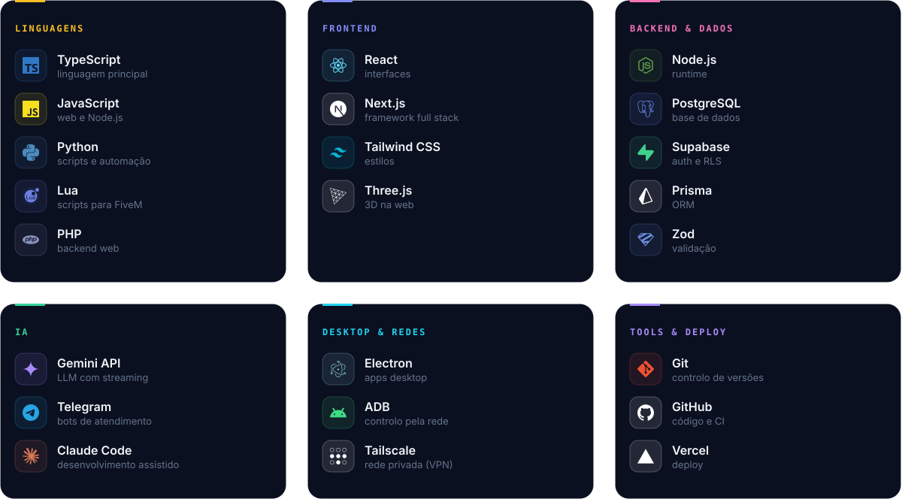

  
  
  

 

Sou developer full stack júnior em Lisboa. Construo aplicações web de ponta a ponta, da base de dados à interface, e uso IA quando acrescenta valor real ao produto. Aprendo de forma autodidata, trabalho como freelancer para pequenos negócios e estou à procura de uma equipa onde possa crescer.

 

## Stack

 

